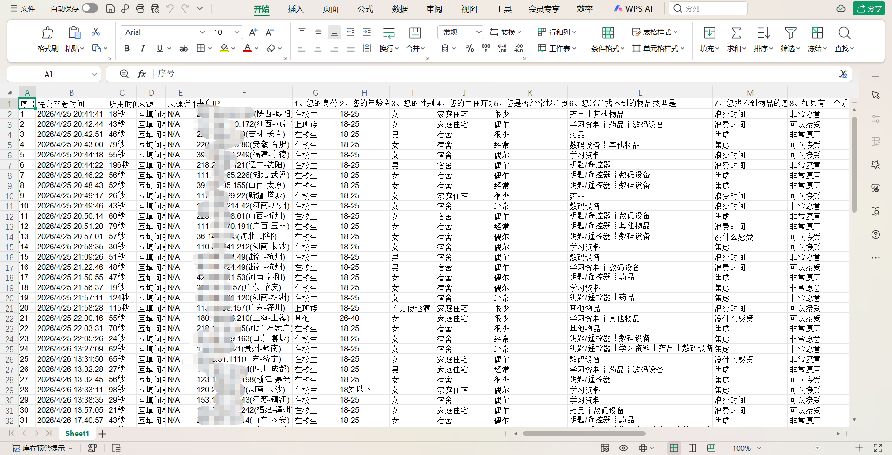
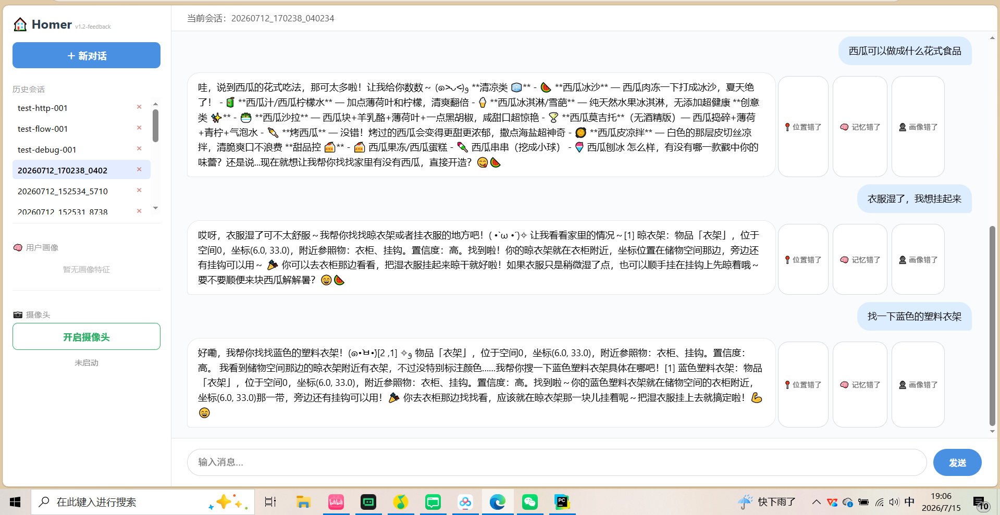
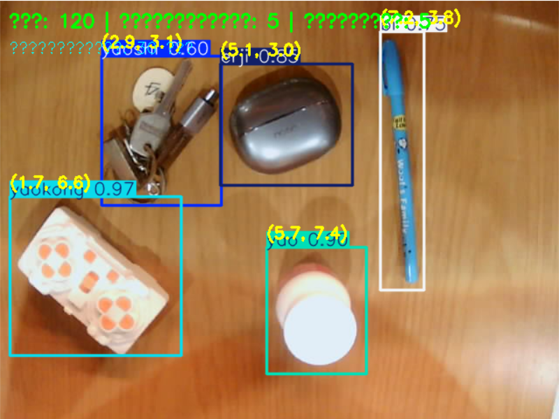
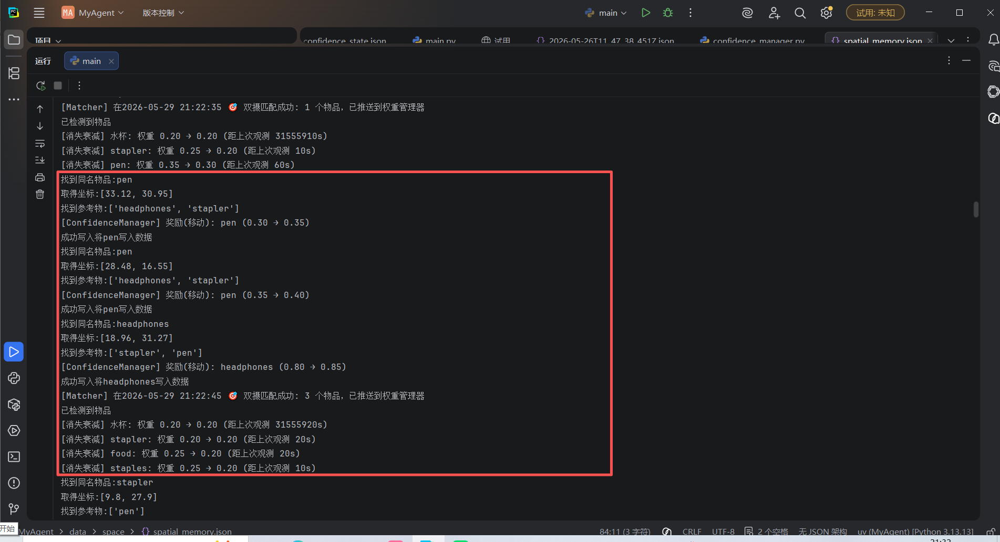
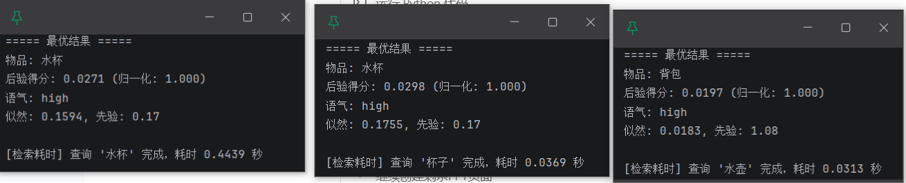
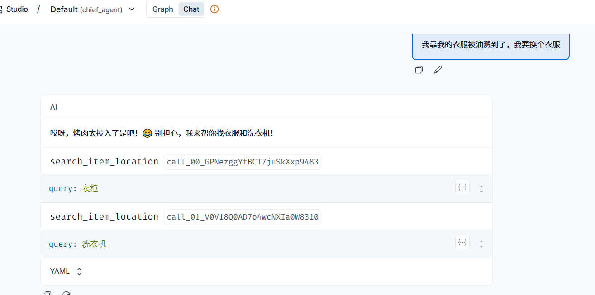
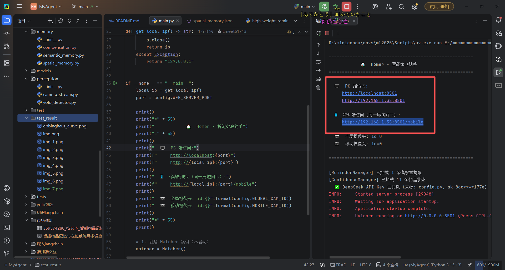

# 🏠 Homer – 具身智能家庭物品记忆助手
### 基于时空变化权重的双记忆检索自反馈系统
#

### 💥 观前提醒！
> * 可观测演示视频：通过网盘分享的文件：homer最基础演示.zip
链接: https://pan.baidu.com/s/1EpOpKRRX5E9EFJiRiyfXqg?pwd=s2eg 提取码: s2eg

#


### ✨✨✨抛出疑问：✨✨✨
> * 你有没有经常遗失或者找不到不怎么常用的物品？
> * 你看过“可塑性记忆”嘛？伴侣机器人10年清除一次记忆，你希望伴侣AI能一直记住你嘛？
> * 都说Attention is all you need,那么有没有想过将“注意力”放在空间物品上？
> * 随着AI需求日益剧增，上下文文本成本以及检索精度目前不可跨越的阻碍。
> * 你希望这个伴侣机器人能调用家里的家电，随着你的生理等变化自动为你调用嘛？

那么本项目就尝试将上诉问题提出自己的想法，请向下看。

#


Homer 是一个集
**双摄像头目标检测**、
**动态物品显著性**、
**空间与语义记忆**、
**动态用户画像**、
**LLM Agent**、
**补偿机制**与**闭环反馈系统**于一体的具身智能家庭物品管理助手。
它能实时观察房间，记住每样东西的位置和"活跃度"，并且在每一次自然对话中逐步了解你的性格偏好；当你对结果不满意时，系统会通过补偿队列提供备选物品，并基于你的反馈自动修正记忆权重，最终像一个真正了解这个家的伙伴一样帮你快速找到物品。

---

### 观前假设：本项目仅仅作者单人完成，物理基础基于2维度空间中验证！！！！！！！！！！！！！！！！！！！！


## ✨ 核心创新


>* **双摄像头交叉验证(YOLO)**
  全局俯视 + 移动视角同步检测。检测>频率为每 30 帧执行一次 YOLO 推理。就如假设所说，如果映射到真实三维度空间，实际考虑的情况以及硬件要求指数及提高，所以没有使用激光雷达、SLAM算法辅助。理解为全局摄像头仅仅获取空间内的维度坐标如（x,y），移动摄像头仅仅识别物品。

>* **动态物品显著性（Object Dynamic Salience）**
  物品不是平等的——越常被移动(常用)的东西越"重要(权重)"，越容易被优先找回(计算分数越高)。
  系统通过"移动奖励 + 静止衰减 + 消失衰减"三线机制，衰减量基于艾宾浩斯遗忘曲线计算（半衰期 120 秒），模拟人类的记忆规律，让记忆随时间自然演化。针对用户的不同情况分析用户当前时间段内最可能需要什么？

>* **空间记忆 + 参照物关系**
  记录物品的坐标(location)、空间编号(space_id)、附近参照物(reference)、特征(fearture)描述及其语义向量(vector)。检索时使用 BGE 模型计算用户查询与物品名称/特征/参照物的**联合似然**，结合权重×置信度的**先验**进行后验排序。

>* **物品使用习惯分析**
  通过长期观测物品在一天中不同时段（早/中/晚/深夜）的被使用频次，自动分析每个物品的常用时段，可在回答中灵活引用，以此强化Agent对数据召回的准确性。目前仅仅分析时间段频次，可往**推荐算法**深入。

>* **语义记忆（对话话题管理）**
  对话会自动分段，每个话题由大模型生成摘要并保存为向量。当用户聊到之前的事情时，Homer 能主动回忆起相关上下文，真正实现长期对话记忆。随着文本的怎加，无论是本地模型还是API调用，前者是时间响应变慢，后者是费用激增。

>* **LLM Agent 自主决策**
  基于 LangChain 的智能体会自主判断何时查询物品位置、何时搜索对话历史、何时提供备选候选，无需固定的唤醒词。你只需要像跟人说话一样，说"我的水杯在哪儿？"“我被淋湿了(系统提问要不要去毛巾)！”

>* **补偿机制 (v1.2 新增)**
  空间检索返回 Top-5 候选时，Top-1 直接展示给用户，Top 2-5 自动存入 SQLite 补偿缓冲队列。当用户否定当前结果（如"不对"“不是这个”）时，Agent 自动调用 `user_correction_feedback` 工具从队列中弹出下一候选，无需重新检索。缓冲队列有过期自动清理机制（默认 1 小时）。

>* **闭环反馈系统 (v1.2 新增)**
  用户否定物品位置后，系统通过贝叶斯更新对物品的置信度/权重进行自适应惩罚。每次否定会记录到物品的 `feedback_history` 中，系统根据 24 小时内连续否定次数动态调整修正力度（alpha 值），多次被否定的物品会被标记为 `high_dispute` 或 `unstable_perception`，确保越用越准确。同时支持对语义记忆和用户画像的反馈修正。

>* **动态用户画像**
  通过对话内容持续提取用户的性格特质、兴趣偏好、价值观、沟通风格和生活习惯五维画像，并应用衰减与奖励机制进行动态调整，在最终回复中融入这些信息，使每一次交互都更个性化。可以理解为假性记忆(肌肉记忆)。

>* **流式前端交互**
  FastAPI + SSE 实现的流式聊天，支持历史会话管理、摄像头一键启停、用户画像可视化。
但注意：本项目没有精美的前端实现想法，因为它不属于软件，它属于具身智能领域。

>* **端到端移动端交互 (v1.1 新增)**
  FastAPI WebSocket 实现手机端与 PC 端实时通信，支持会话列表浏览、历史全量加载、AI 流式回复推送。同一局域网下手机访问 `/mobile` 即可使用。

---

## 🎥 演示截图

* **市场调研，于全国年轻人相对比较希望有遗失物品困难**


#
* **交互界面展示(注意！！！！！！！！真实交互是语音交互，这只是demo)**


#
* **如下类似 global 摄像头检测画面（非最终 puttext 结果），获取像素框中心坐标**


#
* **如下是物品权重增加、衰减机制**
 
#


* **利用贝叶斯模型计算物品的似然，先验概率是物品权重和摄像头的平均置信度**

#
* **核心机制(权重变化)思路源于胜千言**
通过网盘分享的文件：权重演示.mp4
链接: https://pan.baidu.com/s/1itPoFALbLvp4LssmyBa9mA?pwd=v81i 提取码: v81i
* 
#
* **往往会根据物品特征、参照物、物品位置、物品名称、物品描述逐步确定物品位置**


  > * 至于为什么两次水杯结果不同？
  > * 前者是词向量模型每一次都要对三个向量进行前向传播；
  > * 后者是提前保存好向量结果，直接计算。
#
* **Agent 检索量化与效果展示(LangSmith测试)**


  > * 100 个测试数据，30 次测试召回率达到 92%，
  > * 双记忆检索 Agent 的调用准确率约为 84%。
  > * 测试用的是静态数据（spatial_memory.json 文件数据）；
  > * 分别有专属名称检索如"帮我找找水杯"和模糊语义检索如上图所示。
  > * 项目核心概念不仅仅包含准确的数据召回，
  > * 还要能根据用户的需求以及习惯精确进行物品位置检索。
#
* **PC端到移动端交互(局域网内demo)**

* 在移动端打开链接就能进入
* 可以选择话题，模仿主流大模型架构
* 还是注意，这只是demo，真实交互是语音交互
* 下面分别是移动端话题选择展示和交互界面


#

---

## 🧱 系统架构

```
┌────────────────────┐     ┌──────────────────────────────┐
│   PC 端 (Vanilla)   │     │   FastAPI 后端                 │
│   index.html        │◄───►│   /api/chat        (SSE)      │
│   + 摄像头按钮       │     │   /api/camera/*               │
│   + 用户画像面板     │     │   /api/persona/*              │
├────────────────────┤     │   /ws/mobile (WebSocket) ◄────┤
│   移动端 (mobile)    │     │   /mobile  (静态页面)         │
│   mobile.html       │◄───►│   (get_sessions/select/send)  │
│   WebSocket 实时通信 │     └──────────┬───────────────────-┘
└────────────────────┘                 │
                         ┌────────────▼───────────────┐
                         │   LangChain Agent           │
                         │   (deepseek-chat)           │
                         │   + tools:                  │
                         │   - search_item_location    │
                         │   - search_conversation_mem │
                         │   - user_correction_feedback│
                         │   ★ 动态拼接系统提示词        │
                         │   (用户画像 + 物品习惯)        │
                         └────┬──────────────────┬─────┘
                              │                  │
                    ┌─────────▼──┐       ┌──────▼─────────┐
                    │ 空间记忆    │       │ 语义记忆         │
                    │ BGE 检索   │       │ 话题分段+摘要    │
                    │ 乘法似然    │       │ 向量检索         │
                    │ 物品显著性   │       └──────┬──────────┘
                    └──────┬─────┘              │
                           │                    │
                           │        ┌───────────▼──────────┐
                           │        │ 用户性格画像管理器      │
                           │        │ PersonalManager      │
                           │        │ (LLM提取+衰减/奖励)    │
                           │        └───────────┬──────────┘
                           │                    │
            ┌──────────────▼─────┐              │
            │ 物品习惯分析器        │◄─────────────┘
            │ ItemHabitManager   │
            │ (时段频次分析)       │
            └──────┬─────────────┘
                   │
           ┌───────▼─────────────────────────────┐
           │    决策层 (Matcher)                  │
           │  双摄交叉匹配 / ConfidenceManager     │
           │  权重管理(移动奖励/静止衰减/消失衰减)    │
           │  遗忘曲线衰减 / 高权重提醒管理          │
           └───────┬─────────────────────────────┘
                   │
           ┌───────▼──────────────────────┐
           │   补偿机制 + 反馈闭环          │
           │  SQLite 补偿缓冲队列           │
           │  贝叶斯自适应权重修正           │
           │  feedback_history 审计追踪    │
           └───────┬──────────────────────┘
                   │
           ┌───────▼───────┐
           │   感知层        │
           │   YOLOv8 双模型 │
           │   Camera+Mobile │
           │   摄像头驱动    │
           └───────────────┘
```

---

## 🚀 快速开始

### 1. 环境准备

* Python 3.13+
* 两个 USB 摄像头（或内置摄像头 + 外接，也可仅用对话模式）
* 建议使用虚拟环境
* test_result/*.yaml文件是两个YOLO视觉模型配置

本项目使用 [uv]作为包管理器：

```bash
git clone https://github.com/lmeet61713/homer.git
cd homer
uv sync
```

### 2. 配置

在项目根目录创建 `.env` 文件，`config.py` 会自动读取其中的 API Key：

```env
DEEPSEEK_API_KEY=你的DeepSeek_API_Key
```

> 获取地址：https://platform.deepseek.com/api_keys

摄像头参数（若无需摄像头，使用纯对话模式可跳过）在 `config.py` 中配置：

```python
GLOBAL_CAM_ID = 1    # 全局摄像头设备索引
MOBILE_CAM_ID = 2    # 移动摄像头设备索引
```

### 3. 启动

```bash
uv run python main.py
```

打开浏览器访问 `http://localhost:8501`，在侧边栏点击"开启摄像头"启动物体检测，然后就可以在聊天框里向 Homer 提问了。
即使不开启摄像头，系统也能通过纯对话模式进行物品检索和闲聊。

### 由于设备等资源优先，无法像机器人那样长期打开摄像头一直调用YOLO模型，于是选择人工手动打开
---

## 🔬 关键技术剖析
#硬件交互 
### 双摄像头匹配与权重管理

* **检测机制**：全局摄像头和移动摄像头各自独立运行 YOLOv8 推理，每 30 帧执行一次检测(减少设备压力)。
* **交叉匹配**：两个摄像头同时检测到同名物品且置信度(confidence) ≥ 阈值（默认 0.7）时，确认物品存在，记录全局摄像头的物理坐标。
* **参照物提取**：匹配时自动查找全局视角中距离物品最近的 2 个其他物品作为参照物(计算两个目标检测框中心位置最近的)。
* **三线权重模型**：
  * 移动奖励：物品坐标变化超过阈值 → 权重增加（遗忘曲线边际递减）
  * 静止衰减：连续多次未移动 → 步长累计达到阈值后触发衰减(比如角落里不起眼的调味品)
  * 消失衰减：超过 CHECK_INTERVAL 未被任何摄像头观测到 → 触发衰减(比如人超过一定时间不记单词就部分遗忘)
* **遗忘曲线**：衰减量按 `factor = 0.5 ^ (CHECK_INTERVAL / FORGET_HALF_LIFE)` 计算，权重越高衰减越慢。

> 遗忘曲线，见Github

### 物品使用习惯分析（Item Habit Analysis）

* 每次双摄确认观测时，记录物品出现的时间戳和坐标到轨迹文件。
* 后台线程每 300 秒(展示效果才定为300秒)分析一次轨迹数据，按小时将物品出现频次归入早/中/晚/深夜四个时段。
* 分析结果累加到摘要文件，轨迹数据随后清空。
* 摘要信息会注入 Agent 系统提示词，使回答更具个性化（如"水杯通常在早上被使用"）。

### 空间记忆检索

* 使用 BGE 模型将用户查询编码为向量，与物品的 `name`、`features`、`references` 三个字段的预存向量分别计算余弦相似度。
* 乘法似然：`likelihood = sim_name_boosted × sim_features × sim_refs`（带下限保护）。
* 先验：`prior = weight × confidence`。
* 后验分数 = 先验 × 似然，归一化后分为 high / mid / low 三个语气等级。

### 语义记忆（对话话题管理）

* **话题分段**：每轮用户消息的向量与当前区间中心向量计算余弦相似度，低于阈值（默认 0.6）时闭合当前区间。
* **摘要生成**：区间闭合后，调用 `deepseek-chat` 生成用户摘要和 AI 摘要，合并后编码为向量存入文件。
* **检索**：用户触发记忆查询时，用查询向量与所有历史摘要向量匹配，取 top-k 结果（综合向量相似度 + 重要性权重）。

### 动态用户画像

* 五维画像结构：`personality_traits`（性格）、`interests`（兴趣）、`values`（价值观）、`communication_style`（沟通风格）、`habits`（习惯）。
* 每 5 轮对话触发一次 LLM 提取，置信度范围 0.01\~0.99，新特征初始在 0.68\~0.72。
* 应用衰减与奖励机制：稳定特征获得小幅奖励，波动特征施加衰减。
* 画像摘要注入 Agent 系统提示词，前端侧边栏支持可视化查看和删除特征。

### 补偿机制（v1.2 新增）

* 空间检索返回 Top-5 候选时，Top-1 直接格式化返回给 Agent，Top 2-5（`score`、`tone`、`likelihood`、`prior` 等完整信息）自动存入 SQLite 补偿缓冲队列。
* 用户否定结果时，Agent 自动调用 `user_correction_feedback` 工具，从队列中按 position 顺序弹出下一候选，无需重新检索。
* 缓冲队列有过期自动清理机制（默认 1 小时），通过 `cleanup_expired_buffers()` 清理残留数据。
* 队列耗尽时提示用户提供更多线索，引导重新搜索。

### 闭环反馈系统（v1.2 新增）

* **贝叶斯自适应修正**：用户否定物品位置时，对被否定的 Top-1 物品执行权重惩罚（`confidence × (1 - evidence_strength)`）。
* **Adaptive Alpha**：系统根据物品 24 小时内连续否定次数动态调整修正力度，从基础 `FEEDBACK_BASE_ALPHA=0.5` 开始，每次否定递增 `FEEDBACK_ALPHA_STEP=0.1`，上限 `FEEDBACK_MAX_ALPHA=0.9`。
* **审计追踪**：每次修正记录到 `feedback_history` 数组（保留最近 50 条），24h 内否定 ≥ `HIGH_DISPUTE_THRESHOLD=3` 次标记 `high_dispute`，24h 内修正 ≥ 2 次标记 `unstable_perception`。
* **多维度修正**：支持 `location_wrong`（位置修正）、`memory_wrong`（语义记忆降权）、`persona_wrong`（画像特征修正）三种反馈类型。

---

## 📂 目录结构

```
homer/
├── main.py                 # 入口
├── config.py               # 全局配置
├──
├── application/            # 后端服务层
│   ├── web_ui.py           # FastAPI 后端（含 SSE 流式聊天、WebSocket 端到端交互、画像接口）
│   ├── data_exporter.py    # 会话/记忆/向量文件读写
│   └── static/
│       ├── index.html      # PC 端前端界面
│       └── mobile.html     # 移动端交互界面（WebSocket 实时通信）
├──
├── Agent/                  # LangChain Agent 层
│   ├── agent.py            # Agent 管理器（动态注入画像+习惯，支持 3 个工具）
│   ├── tools.py            # 工具定义（search_item_location / search_conversation_memory / user_correction_feedback）
│   └── tool_context.py     # 请求级上下文传递（contextvars，含补偿队列 ID）
├──
├── memory/                 # 记忆层
│   ├── spatial_memory.py   # 空间记忆检索（BGE 向量 + 乘法似然 + 先验后验）
│   ├── semantic_memory.py  # 语义记忆（BGE 模型单例、话题分段、摘要生成、向量检索）
│   └── compensation.py     # 补偿缓冲队列（SQLite，Top 2-5 候选存储与弹出）
├──
├── feedback/               # 反馈系统
│   ├── dispatcher.py       # 反馈分发器（贝叶斯修正 + adaptive alpha + unstable 标记）
│   ├── router.py           # FastAPI 路由（Module A 自反馈接口）
│   ├── schemas.py          # 反馈数据模型
│   └── metrics.py          # 反馈指标统计
├──
├── perception/             # 感知层
│   ├── camera_stream.py    # 摄像头驱动（GlobalCamera / MobileCamera）
│   └── yolo_detector.py    # YOLOv8 目标检测（双模型：全局 + 移动）
├──
├── decision/               # 决策层
│   ├── matcher.py          # 双摄像头匹配引擎（30 帧检测 + 交叉匹配 + 保存循环）
│   ├── confidence_manager.py  # 权重管理器（移动奖励/静止衰减/消失衰减 + 遗忘曲线 + 反馈审计）
│   ├── high_weight_reminder.py # 高权重物品提醒管理器
│   └── personal/           # 个性化模块
│       ├── Peronal_manager.py  # 用户性格画像管理器（五维 + LLM 提取 + 衰减奖励）
│       └── item_habit_analyzer.py # 物品使用习惯分析器（时段频次分析）
├──
├── models/                 # YOLOv8 模型权重
│   ├── best_global.pt      # 全局摄像头模型
│   ├── best_mobile.pt      # 移动摄像头模型
│   └── yolov8n.pt          # 官方预训练轻量模型
├──
├── data/                   # 运行时数据（自动生成）
│   ├── space/              # 空间记忆 + 置信度状态 + 物品轨迹 + 习惯摘要
│   │   ├── spatial_memory.json
│   │   ├── confidence_state.json
│   │   ├── item_trajectories.json
│   │   └── item_habits_summary.json
│   ├── memory/             # 对话会话（每会话独立 JSON）
│   ├── vectors/            # 语义记忆向量（每 session 子目录）
│   ├── abstract/           # 话题摘要文件
│   ├── persona/            # 用户画像文件
│   ├── feedback/           # 反馈事件/错误/指标日志
│   ├── reminder/           # 高权重提醒状态强调文本
│   └── compensation.db     # 补偿缓冲队列数据库
└──
```

> **版本：v1.2 · 补偿机制 + 反馈闭环**（2026-07-13）
> 看见房间，记住物品，在对话中成长——回答你的每一个"找东西"的问题。


---

### 项目质疑以及缺点
> * 本项目依旧选择LLM模型而不是世界模型，因为这个方向具身智能作为AI伴侣，我认为文本理解能力占主导
> * 刚开始制作demo，数据存储上用的是json格式，如果能拓展，打算将语义文本(memory)作为SQL存储
> * 全局摄像头用于定位，移动摄像头用于识别
> * 项目映射到3维物理空间难度指数增加，单人难以实现
> * 这里只有三个Agent，分别是语义、空间与自反馈，不是不会设计其他多模态Agent，而是打算垂直领域发展检索机制。
> * 由于计算机网络学的较浅，所以端到端演示只是单局域网里
> * 没有充分考虑上千数据展示召回测试
> * 关于“物品特征”这一点目前还停留在概念，因为用的是自训练模型，所以还没能做到提取特征。
> * 
---

## 🔭 未来计划（Roadmap）

* [x] **补偿机制**：用户否定时从备选队列弹出候选，无需重新检索（v1.2 已完成）
* [x] **闭环反馈修正**：基于贝叶斯更新的自适应权重修正与审计追踪（v1.2 已完成）
* [X] **前端摄像头实时画面**：在前端展示全局和移动摄像头的检测画面。
* [ ] **对话反馈空间修正**：从用户纠正语句中自动更新物品位置和参照物。
* [ ] **物品关系图可视化**：在前端展示物品之间的关联网络。
* [ ] **更细粒度的对话反馈解析**：利用更强模型提取用户隐含的意图与纠正。
* [ ] **视觉特征融合**：引入 CLIP 等模型，直接用图像特征强化空间记忆。
* [ ] **多空间/多用户支持**：为不同房间和家庭成员维护独立的记忆和画像。
* [ ] **主动推送**：当某物品显著性异常升高但用户长时间未询问时，主动提醒。
* [ ] **开放 API**：提供标准化 REST API，便于集成到智能音箱、机器人等平台。

---

## 🧪 学术与商业价值

* **学术**：Homer 在类具身智能中即将引入**基于遗忘曲线的自适应物品显著性**和**对话驱动的动态用户画像**，探索了持续学习的服务机器人在家庭场景下的交互范式。
* **商业**：面向健忘人群、老年人、共享居住空间等，提供一种越用越懂你的物品管理方案。

---

## 📜 开源协议

本项目采用 [MIT License](LICENSE)。

---

## 🙏 致谢

感谢所有开源项目的支持，包括但不限于：

Ultralytics YOLO  LangChain  DeepSeek  BGE  FastAPI