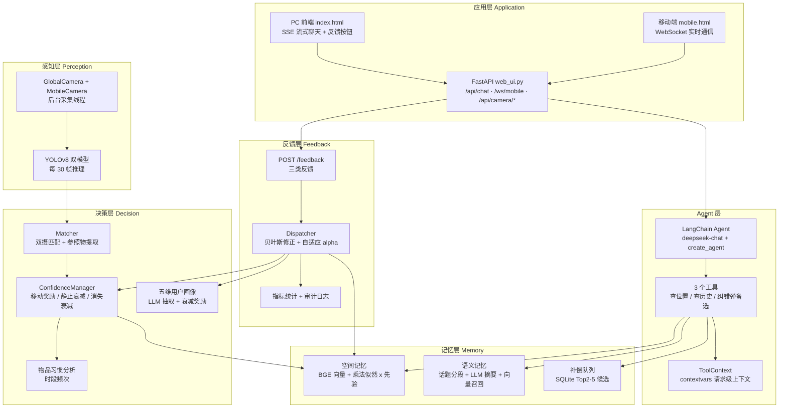

# 系统架构与设计思路

## 一、分层架构

## 二、各层职责

| 层 | 职责 | 关键文件 |
|---|---|---|
| 感知层 | 摄像头采集 + YOLO 检测 + 物理坐标映射 | `perception/camera_stream.py`、`perception/yolo_detector.py` |
| 决策层 | 双摄交叉匹配、权重管理、习惯 / 画像分析 | `decision/matcher.py`、`decision/confidence_manager.py`、`decision/personal/` |
| 记忆层 | 空间 / 语义双记忆检索、补偿队列 | `memory/spatial_memory.py`、`memory/semantic_memory.py`、`memory/compensation.py` |
| Agent 层 | 工具调用决策、上下文传递、系统提示词 | `Agent/agent.py`、`Agent/tools.py`、`Agent/tool_context.py` |
| 反馈层 | 用户纠错入口、贝叶斯修正、审计 | `feedback/router.py`、`feedback/dispatcher.py` |
| 应用层 | HTTP / WebSocket 接口、前端页面、数据导出 | `application/web_ui.py`、`application/data_exporter.py`、`application/static/` |

## 三、关键设计决策（Why）

1. **为什么双摄像头交叉验证？**
   单摄像头 YOLO 误检率高。全局俯视摄像头能拿到绝对坐标，移动摄像头能近距离确认类别，两者同时看到同名物品才写入记忆——用"多视角一致"对抗"单视角误判"。

2. **为什么用艾宾浩斯遗忘曲线做权重？**
   物品不是平等的：常用的（水杯、手机）应优先被找到，很久不动的物品应慢慢降低显著性。用半衰期 120 秒的指数衰减模拟"记忆随时间自然淡忘"，高频移动的物品获得奖励、权重越高衰减越慢——符合"越常用记得越牢"的直觉。

3. **为什么检索用"乘法似然 × 先验"？**
   用户描述往往模糊（"带盖子的杯子"），需要语义相似度；但语义相近的物品很多（水杯 vs 保温杯），需要活跃度打破平局。后验 = (weight×confidence) × sim(name) × sim(features) × sim(refs)，乘法框架让任何一维相似度太低都会显著拉低总分，语义 + 活跃度联合排序。

4. **为什么要补偿队列？**
   Top-1 答错时重新检索会得到几乎相同的结果，用户还得换措辞，体验断裂。所以 Top 2-5 提前存进 SQLite 队列，用户说"不对"时直接弹出下一个候选，并同步对答错的物品降权——把"纠错"变成一次轻量操作。

5. **为什么要自反馈闭环？**
   任何 AI 系统都会错。核心卖点是"系统从错误中学习"：三类反馈（位置错 / 记忆错 / 画像错）进入贝叶斯修正引擎，更新空间记忆置信度、权重审计、语义记忆重要度、画像特征置信度；连续被否定 3 次的物品自动标记 `high_dispute`，后续回答语气降级。

6. **为什么要五维画像 + 习惯分析？**
   检索排序只解决"找得到"，个性化解决"回答得像懂你"。画像每 5 轮抽取并做锚点衰减（稳定特征奖励、波动特征衰减），习惯按早 / 午 / 晚 / 深夜统计使用时段，两者动态注入 Agent 系统提示词，让回答能引用"你早上常用这个水杯"这类上下文。

## 四、与普通聊天机器人的区别

| 维度 | 普通 Chatbot | Homer |
|---|---|---|
| 感知 | 无 | 双摄 + YOLO，真实观察房间 |
| 记忆 | 上下文窗口 | 空间记忆 + 语义记忆，长期落盘 |
| 权重 | 无 | 遗忘曲线动态显著性 |
| 纠错 | 用户忍 | 反馈闭环，贝叶斯自动修正 |
| 个性化 | 提示词写死 | 动态画像 + 习惯注入 |
