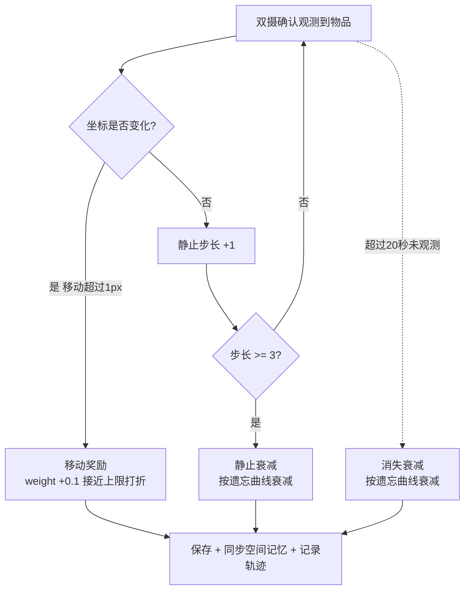
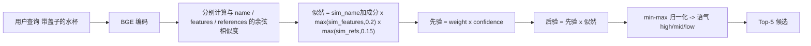
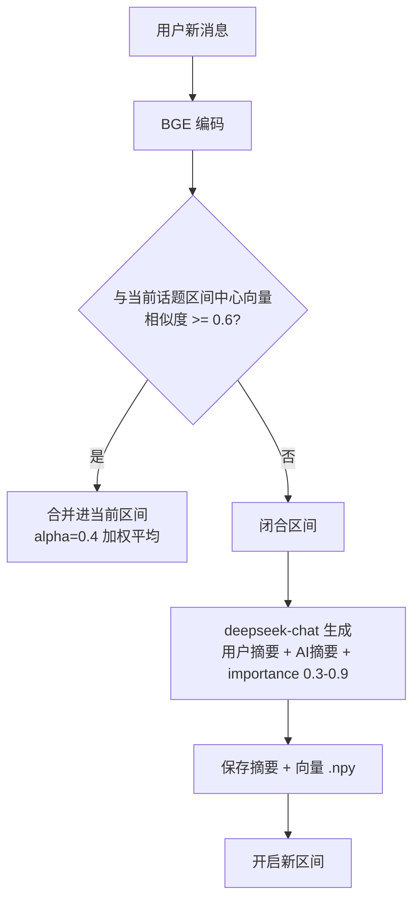

# 核心机制与算法

## 一、物品权重三线模型

三条触发线共同决定物品"显著性权重"：

参数（`config.py`）：

| 参数 | 值 | 含义 |
|---|---|---|
| INITIAL_WEIGHT | 0.5 | 新物品初始权重 |
| MAX_WEIGHT / MIN_WEIGHT | 0.99 / 0.20 | 权重上下限 |
| WEIGHT_REWARD_INCREMENT | 0.1 | 移动奖励（权重 ≥ 0.85 时按剩余空间打折） |
| DECAY_COUNTER_MAX | 3 | 连续静止 3 次触发静止衰减 |
| CHECK_INTERVAL | 20 秒 | 匹配 / 消失检查周期 |
| FORGET_HALF_LIFE | 120 秒 | 遗忘半衰期 |

遗忘曲线衰减量：

$$ factor = 0.5^{\frac{CHECK\_INTERVAL}{FORGET\_HALF\_LIFE}} \approx 0.89,\qquad decay = w - w \times factor $$

即每个 20 秒周期衰减到原来的约 89%；权重越高每次衰减的绝对量越大（相对比例相同），接近下限时衰减趋缓。

## 二、空间记忆检索（乘法似然 × 先验）

- name 相似度 ≥ 0.7 时加分 +0.15（封顶 0.99）
- features / refs 有下限保护（0.2 / 0.15），防止某维为 0 直接抹杀结果
- 归一化后 ≥ 0.7 → "高置信"，≥ 0.4 → "中置信"，否则 "低置信"
- Top-1 格式化返回给 Agent，Top 2-5 写入补偿队列

## 三、语义记忆（对话话题分段）

检索时：查询向量与所有区间向量做余弦匹配，得分 = 0.7 × 相似度 + 0.3 × 重要性，命中后把摘要和原始对话片段拼给 Agent，实现"你昨天聊过的那件事"的长期记忆。

## 四、自反馈与贝叶斯修正

三种反馈类型：

| 类型 | 触发 | 修正目标 |
|---|---|---|
| location_wrong | 物品位置答错 | spatial_memory 置信度下降 + confidence_state 权重审计 |
| memory_wrong | 对话记忆被否认 | 对应摘要 importance × 0.5 + 否定标记 |
| persona_wrong | 画像判断错误 | 该特征置信度下降，建议特征置信度上升 |

贝叶斯更新原语：

$$ new = \begin{cases} c + (1-c) \times ev, & direction=+1 \\ c \times (1 - ev), & direction=-1 \end{cases},\qquad ev = confidence_{user} \times \alpha $$

自适应 alpha：物品 24 小时内每被否定一次，alpha = 0.5 + 0.1 × 次数，上限 0.9——越频繁被否定，修正越激进。

审计规则：24 小时内 ≥ 3 次否定 → 标记 `high_dispute`；≥ 2 次修正 → 标记 `unstable_perception`；每次修正写入 `feedback_history`（保留最近 50 条）。

## 五、五维用户画像

- 维度：personality_traits / interests / values / communication_style / habits
- 每 5 轮对话触发一次 LLM 抽取（新特征置信度 0.68 ~ 0.72）
- 锚点衰减：与 base 快照对比，稳定特征 +0.03 奖励，衰退特征 -0.05，波动特征小幅奖励
- 每个维度最多保留 15 个特征，按置信度淘汰
- 摘要注入 Agent 系统提示词

## 六、物品习惯分析

- 每次双摄确认记录轨迹（时间 + 坐标，自动去重）
- 每 300 秒聚合一次，按 早(6-12) / 午(12-18) / 晚(18-24) / 深夜(0-6) 累加计数
- 输出"水杯通常在早上被使用（累计 5 次）"注入提示词

## 七、补偿候选队列（SQLite）

- `search_item_location` 返回 Top-5：Top-1 直接回答，Top 2-5 写入 `compensation_queue` 表
- 用户否定 → `user_correction_feedback` 按 position 顺序弹出下一个候选
- 队列 TTL 1 小时自动清理；新查询会清空旧队列
