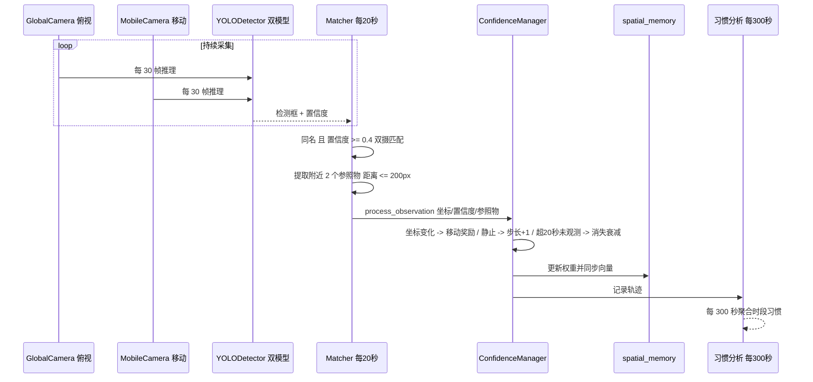
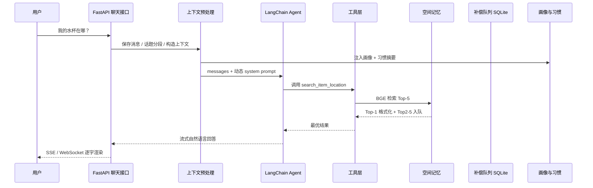
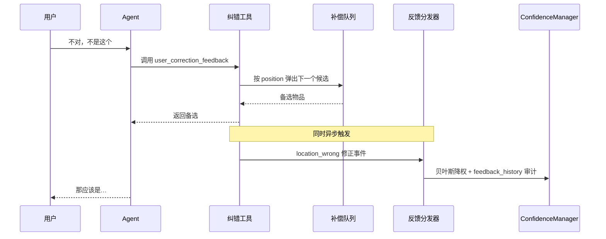

# 完整交互流程

## 主线一：感知链路（摄像头 → 空间记忆）

## 主线二：对话链路（用户提问 → Agent → 检索 → 回答）

## 主线三：纠错闭环（用户否定 → 备选 + 修正）

## 状态与上下文传递

- `ToolContext`（contextvars）：session_id、all_messages、compensation_buffer_id、last_top1_item，跨工具调用传递
- 会话文件记录：messages、count_session、segment_start、interval_vec（话题区间状态）
- 回答保存：assistant 回复流式结束后写入会话 JSON；空响应 / 异常有兜底消息，保证 PC 与移动端消息完整
- 流式修复记录：`agent.stream(..., subgraphs=False)` 确保 LangGraph 1.x 下正确解构消息 chunk（详见 `.trae/documents/fix-sse-streaming-root-cause.md`）
